# Data model (core relationships)

SQL Server schema created by EF Core migrations (`InitialCreate`: 117 tables; `ProtectionTriggers`: immutability/audit
triggers). All business tables carry `TenantId` (global query filter); money is `decimal(19,4)`, timestamps are UTC `datetime2`.
Dynamic customer attributes use a typed EAV table — no column is ever added per custom field.

```mermaid
erDiagram
    Tenant ||--o{ AppUser : has
    AppUser }o--o{ Role : "UserRoles"
    Role }o--o{ Permission : "RolePermissions"

    Customer ||--o{ CustomerIdentification : "encrypted ID + HMAC token"
    Customer ||--o{ CustomerContact : has
    Customer ||--o{ CustomerFinancialProfile : "effective-dated"
    Customer ||--o{ CustomerDocument : has
    Customer ||--o{ CustomerFieldValue : "typed EAV, effective-dated"
    CustomerFieldDefinition ||--o{ CustomerFieldValue : "code + version"
    CustomerFieldDefinition ||--o{ CustomerFieldOption : options
    CustomerFieldGroup ||--o{ CustomerFieldDefinition : groups
    Customer ||--o{ CustomerFieldChangeHistory : history
    Customer ||--o{ OwnershipLink : "entity owned/controlled by"
    Customer ||--o{ CustomerAcceptanceDecision : decisions
    Customer ||--o{ EddTask : tasks
    Customer ||--o{ CustomerExitRequest : exits
    Customer ||--o{ Wallet : owns
    Wallet ||--o{ Wallet : "parent/sub-wallet"
    WalletMapping }o--|| Wallet : "internal/clearing classification"

    RiskMethodology ||--o{ RiskFactorDefinition : factors
    RiskFactorDefinition ||--o{ RiskFactorScoreMapping : mappings
    RiskMethodology ||--o{ RiskThreshold : thresholds
    RiskMethodology ||--o{ RiskOverridePolicy : "mandatory overrides"
    RiskMethodology ||--o{ RiskCategoryFloor : floors
    Customer ||--o{ CustomerRiskAssessment : "immutable snapshots"
    CustomerRiskAssessment ||--o{ CustomerRiskAssessmentFactor : "factor evidence"
    Customer ||--|| CurrentCustomerRiskProfile : current
    Customer ||--o{ RiskOverrideRequest : overrides
    Customer ||--o{ RiskReviewTask : reviews

    IngestionRun ||--o{ IngestionRecord : records
    IngestionRecord ||--|| RawTransactionPayload : "restricted raw"
    Transaction }o--|| IngestionRun : "loaded by"
    Transaction ||--o{ TransactionStatusHistory : "source statuses"
    Transaction ||--o{ TransactionPartyResolution : "original vs economic parties"
    Transaction }o--o| Transaction : "reversal/refund of"
    Customer ||--o{ CustomerDailyAggregate : "incremental aggregates"

    AmlRule ||--o{ AmlRuleVersion : versions
    AmlRuleVersion ||--o{ AmlRuleExecution : executions
    AmlAlert }o--|| AmlRuleVersion : "rule version"
    AmlAlert ||--o{ AmlAlertRuleMatch : "immutable match evidence"
    AmlAlert }o--o{ Transaction : "AmlAlertTransactions"
    AmlAlert }o--o{ Customer : "AmlAlertCustomers"
    AmlAlert ||--o{ AlertStatusHistory : history
    AmlCase }o--o{ AmlAlert : "AmlCaseAlerts"
    AmlCase }o--o{ Transaction : "AmlCaseTransactions"
    AmlCase }o--o{ Customer : "AmlCaseCustomers"
    AmlCase ||--o{ AmlCaseNote : "immutable notes"
    AmlCase ||--o{ AmlCaseTask : tasks
    AmlCase ||--o{ AmlCaseDocument : evidence
    AmlCase ||--o{ RegulatoryReport : "STR/SAR (from case only)"
    RegulatoryReport }o--o| RegulatoryReport : "amends/continues"

    WatchlistSource ||--o{ WatchlistVersion : versions
    WatchlistSource ||--o{ WatchlistEntry : entries
    ScreeningRequest ||--o{ ScreeningResult : results
    ScreeningResult ||--o{ ScreeningReviewHistory : reviews
    AllowListEntry }o--|| ScreeningResult : "cleared FP"

    ComplianceAction }o--o| ScreeningResult : "triggered by"
    ComplianceAction ||--o{ AuthorityNotification : "freeze notifications"
    RealtimeDecision ||--o| HoldQueueItem : holds
    Transaction }o--o| RealtimeDecision : "linked decision"

    EntityLink }o--|| Customer : "A"
    EntityLink }o--|| Customer : "B"
    Customer ||--o{ CustomerDeviceSignal : devices

    AuditLog { bigint Id PK  datetime2 TimestampUtc  string Actor  string Action  string Hash "HMAC, append-only trigger" }
```

Immutability enforced in the database by triggers: `AuditLogs` (no update/delete), `CustomerRiskAssessments` and
`CustomerRiskAssessmentFactors`, `AmlAlertRuleMatches`, `AmlCaseNotes`, submitted `RegulatoryReports`.
